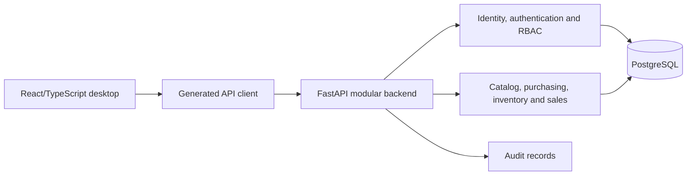

# AgencyAI — business-software development case study

AgencyAI is an ongoing personal development project by Hussein Nabil Akil. It explores a modular POS and business-management architecture. It is not a completed commercial product or a deployed service.

## Implemented source inspected

The current local tree contains identity/authentication, role-based access control, organization/branch membership, tenant isolation and audit modules. It also contains catalog, supplier/purchasing, inventory-ledger and sales/checkout modules, with migration and API tests. Source presence is evidence of implementation, not verification of every workflow in operation.

The backend uses Python, FastAPI, SQLAlchemy and PostgreSQL. The desktop application uses React and TypeScript in a Tauri project. API contracts feed a generated TypeScript client.

## Validation on 13 October 2026

- `pnpm test`: seven test files, **34 passing tests**.
- `pnpm build:desktop`: TypeScript checking and Vite frontend build passed.
- `python -m pytest tests/test_phase4_arithmetic.py tests/test_passwords.py -q`: **15 passing tests**.

The backend selection covers arithmetic and password behavior. PostgreSQL integration tests, tenant RLS behavior, full end-to-end flows, native Tauri packaging, and production deployment were not rerun in this audit. The working tree contains unfinished changes; no source or historical commits are published by this case study.

## Planned work

SQLite persistence, synchronization, Android, industry-specific modules, accounting/FX, analytics and AI remain planned according to inspected documentation. Module names and design documents must not be interpreted as completed implementations.

## Engineering priorities

Complete a reproducible isolated PostgreSQL integration run, document a synthetic-data sales/inventory demo, and verify native desktop packaging. Then publish a reviewed source subset when it is appropriate to make the code public.
